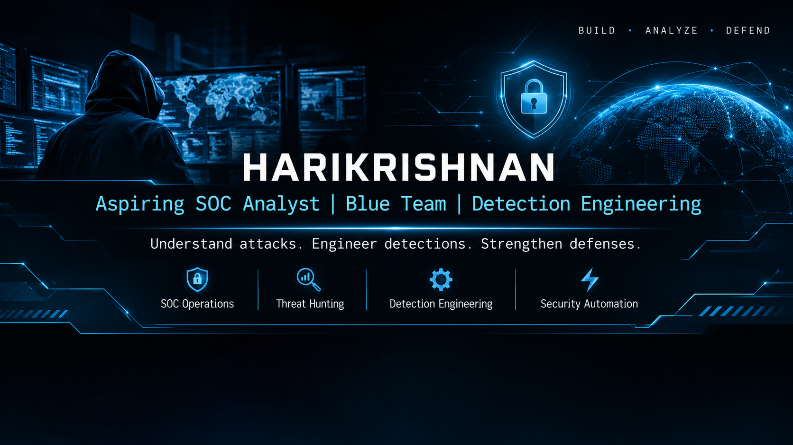

  

 

## About Me

I'm an aspiring **SOC Analyst** focused on Blue Team operations, Detection Engineering, Threat Hunting, and Incident Response.

I enjoy building hands-on security labs, simulating real-world attack techniques, analyzing security telemetry, and developing detections that turn raw events into actionable security insights.

My approach is simple: **Build things. Break things. Understand them.**

Currently expanding my knowledge of SIEM operations, Windows and Active Directory security, MITRE ATT&CK, and security automation.
## Technical Skills

| Category | Technologies & Tools |
|---|---|
| **SIEM & Security Monitoring** | Wazuh, Splunk |
| **Endpoint & Network Security** | Sysmon, Suricata, Windows Event Logs |
| **Active Directory Security** | Active Directory, BloodHound, Impacket, NetExec |
| **Detection Engineering** | Wazuh Custom Rules, MITRE ATT&CK, Sigma fundamentals |
| **Threat Hunting & Analysis** | Log Analysis, Event Investigation, Detection Validation |
| **Incident Response** | Alert Triage, Incident Investigation, Containment, Eradication, Recovery |
| **Security Automation** | n8n, Python, PowerShell, Bash |
| **Visualization & Dashboards** | Grafana |
| **Web Application Security** | ModSecurity, OWASP Core Rule Set, DVWA |
| **Operating Systems** | Windows, Windows Server, Linux, Kali Linux |
## Featured Projects

### 1. SOC Active Directory Detection & Incident Response Lab
[GitHub Repository](https://github.com/Harikrishnan-P97/SOC-Active-Directory-Detection-and-Response-Lab)

A hands-on Active Directory SOC environment focused on attack simulation, detection engineering, threat hunting, and incident response.

- Built a Windows Active Directory environment with centralized monitoring using Wazuh.
- Developed and validated **42 custom Wazuh detection rules**.
- Created **7 SOC dashboards** for security monitoring and investigation.
- Documented **7 incident response playbooks**.
- Mapped detection scenarios to MITRE ATT&CK.

### 2. SOC Automation & Detection Engineering Lab
[GitHub Repository](https://github.com/Harikrishnan-P97/SOC-Automation-Detection-Engineering-Lab)

A security operations lab integrating SIEM monitoring, network security, alert automation, and incident response workflows.

- Integrated Splunk, Suricata, and ModSecurity for security monitoring.
- Built automated alert workflows using n8n.
- Integrated Grafana for SOC alert visualization.
- Connected Slack for security alert notifications.
- Implemented automated endpoint containment using LimaCharlie.

### 3. SOAR + EDR Home Lab
[GitHub Repository](https://github.com/Harikrishnan-P97/SOAR-EDR-Home-Lab)

A hands-on security automation and endpoint response environment exploring the integration of detection, alerting, orchestration, and endpoint containment.

- Explored automated security alert handling and response workflows.
- Worked with endpoint detection and response concepts.
- Practiced security orchestration and containment workflows.

### 4. CliHax – Cybersecurity CLI Tool
[GitHub Repository](https://github.com/Harikrishnan-P97/clihax)

A Python-based command-line cybersecurity tool focused on developing practical security utilities and improving command-line workflows.

- Developed a structured CLI application using Python.
- Worked with Poetry for dependency and project management.
- Focused on usability, maintainability, and professional project structure.
## Certifications & Learning

### Professional Certifications & Practical Training

- **Certified Ethical Hacker (CEH v12)** – EC-Council
- **Practical Ethical Hacking (PEH)** – TCM Security
- **Security Analyst Level 1 (SAL1)** – TryHackMe *(Training Completion)*

### Security & Technical Training

- **Foundations of Operationalizing MITRE ATT&CK** – AttackIQ
- **Splunk: Zero to Power User** – Udemy
- **Introduction to Splunk** – Splunk
- **Using Fields in Splunk** – Splunk
- **Cisco Cybersecurity Training** – Cisco Networking Academy
- **NDG Linux Certifications** – Cisco Networking Academy
- **Complete Python Bootcamp: From Zero to Hero** – Udemy

### Additional Learning

Continuously expanding my knowledge through hands-on labs, cybersecurity training, detection engineering exercises, and practical security research.